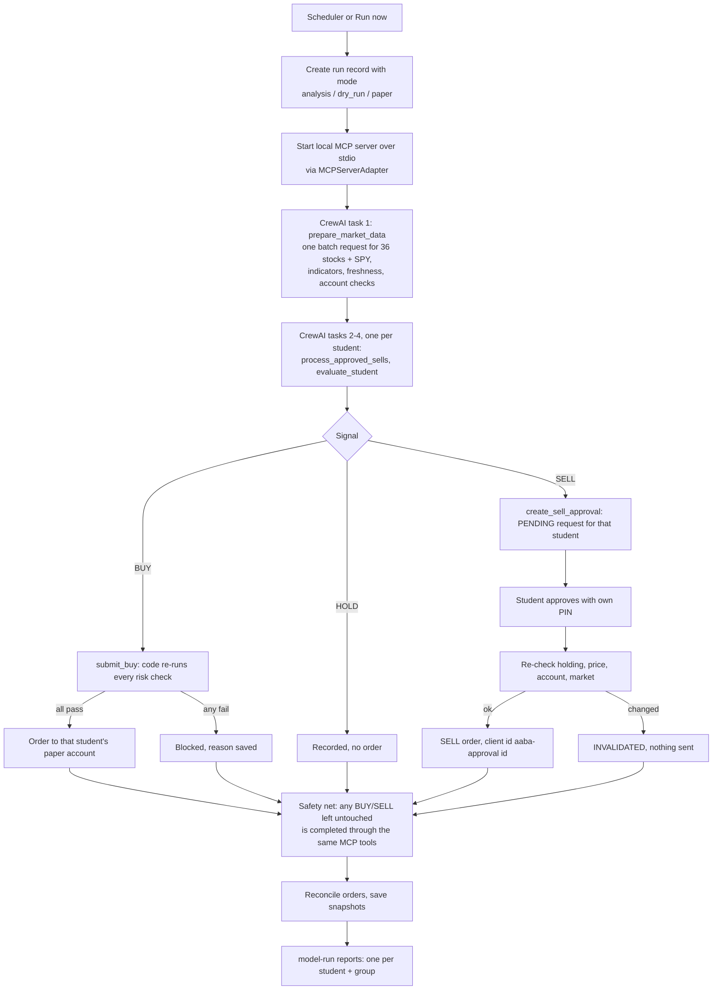

# Architecture

This follows the group's final architecture diagram: one shared orchestrator, three configurable
student modules, three paper accounts, and SELL approval by a person.

## How the diagram maps to the code

| Diagram box | Where it lives |
|---|---|
| 1. Scheduler and trigger | `aaba/scheduler.py` (APScheduler, New York time, Alpaca calendar), dashboard "Run now", `main.py run` |
| 2. Shared orchestrator / main agent | `agents/trading_crew.py`: one CrewAI `Agent`, one `LLM` from `aaba/llm.py`, sequential `Crew` |
| 3. Three student modules | `configs/students.json` (universe, capital, env prefix) + `configs/strategy.json`; they are settings, not separate agents |
| 4. Market data | `aaba/market_data.py` (one batch request for all 37 symbols) |
| 4. Indicators | `aaba/indicators.py` (EMA, RSI, MACD, ATR, Bollinger, OBV) |
| 4. Strategy engine | `aaba/strategy.py` (`evaluate_symbol`, shared with the backtest) |
| 4. Risk manager | `aaba/risk.py` (`check_buy`, `check_sell`) |
| 5. Decision and execution controller | `aaba/controller.py` |
| 6. Approval interface | `aaba/approvals.py` + Approval Centre page + `main.py approve` |
| 7. Account-specific execution | `aaba/broker.py` (paper-only client per student, duplicate-safe orders in `controller.place_order`) |
| 8. Monitoring, audit logs, dashboard | `aaba/db.py` (SQLite), `aaba/reports.py` (`model-run/`), `app/streamlit_app.py` |
| MCP server (brief section 8) | `mcp_server/technical_indicators_server.py`, stdio |
| MCP client (brief section 8) | `crewai_tools.MCPServerAdapter` in `agents/trading_crew.py`; stand-alone test in `mcp_server/mcp_client_test.py` |

## One run, step by step

## Why the work is split this way

The LLM never produces a number that is used for trading. Indicators, signals, quantities and every
risk rule are plain Python. The agent's job is to run the steps through the MCP tools, decide whether
to hold back a BUY when the evidence argues against it (it may only make things more cautious), and
explain the outcome. The tools re-check everything themselves, so calling them in the wrong order or
with a made-up signal id does nothing harmful: an unknown id is refused, a HOLD cannot be bought, a
SELL cannot be cancelled by the agent, and a signal can be acted on once.

LLMs sometimes skip steps. After the crew finishes, the safety net looks for any BUY or SELL signal
in this run that has no outcome and calls the same MCP tool for it. The report lists every action the
safety net took, so it is visible how often the agent followed through on its own. If no LLM is set
up, or it fails, the safety net runs the whole workflow and the run is labelled "rules-only".

## Keeping students apart

- Each student's keys come from their own env prefix (`STUDENT1_`, `STUDENT2_`, `STUDENT3_`).
- Every table that holds student data has a `student_id` column, and the read helpers require it.
- A signal can only be acted on for the student it was created for, and only for stocks in that
  student's list.
- Account numbers are recorded and compared. Two students on the same account means orders are
  blocked for both.
- Approvals are bound to student, account, stock, quantity and signal by a fingerprint.

## Data and time

- Daily bars: one request to Alpaca for all symbols, SIP feed ending 16 minutes ago (free-plan
  limit), with IEX as the fallback. Today's bar is dropped while the session is open, so decisions use
  the last completed day only.
- Freshness: the latest bar must be the last completed session according to Alpaca's calendar. If
  not, every BUY and SELL becomes HOLD for that run.
- Latest prices: one request (IEX), must be under 15 minutes old to trade.
- Timestamps are stored in UTC. Market logic uses New York time. Report names use IST.

## Persistence

`data/aaba.db` (SQLite, WAL mode) holds runs, market snapshots, signals, orders, approvals, approval
attempts, events, account checks and portfolio snapshots. Restarting the app or the laptop keeps
everything, including pending approvals. Indicator tables for each run are saved as CSV in
`data/indicators/<run id>/` with the same columns as the old project's CSVs.
